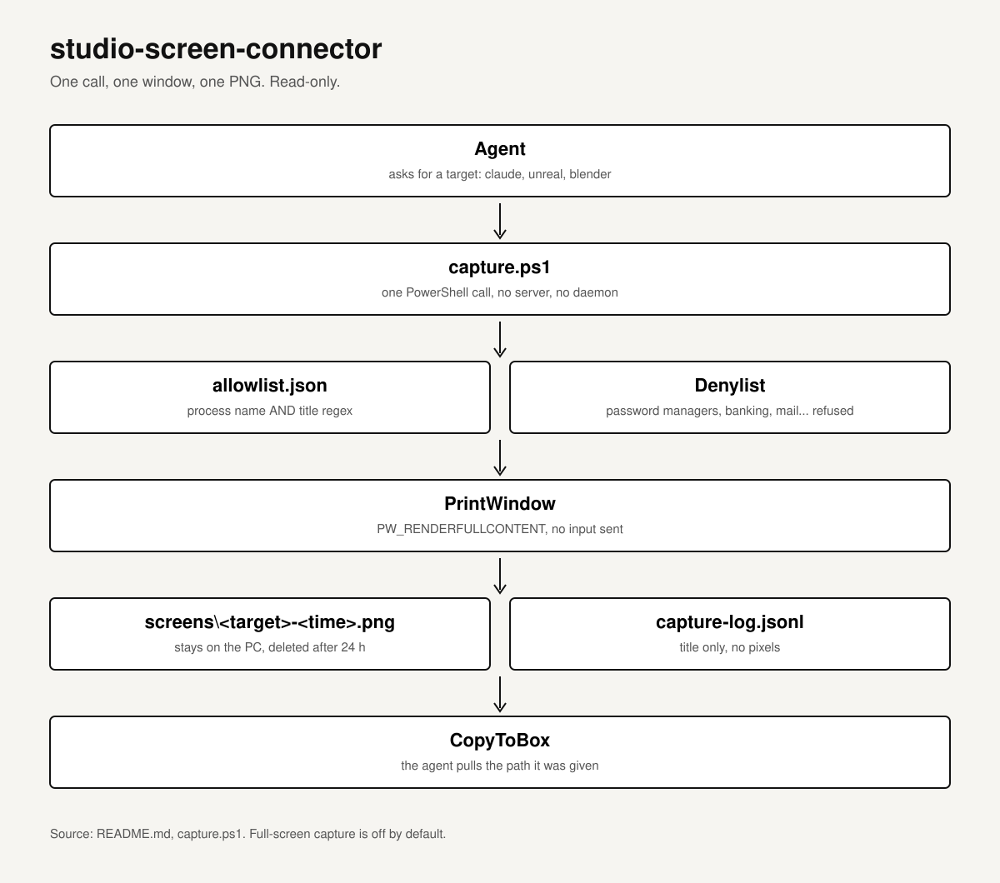

# studio-screen-connector

**Let a remote agent see one allowlisted window on a Windows PC: one read-only PowerShell call, one PNG, nothing uploaded.**

<p align="center"></p>

Read-only, on-demand screenshots of allowlisted windows on a Windows PC (the Claude desktop app, Unreal Editor,
Blender), so a remote agent can see what Claude is doing. One PowerShell call per capture: no server, no daemon,
no input sent, nothing uploaded. The PNG stays on the PC until the agent copies it.

Based on `extension/server/win.ps1` from [claude-unreal-connector](https://github.com/RicheyWorks/claude-unreal-connector)
(EnumWindows + PrintWindow with PW_RENDERFULLCONTENT); its UnrealEditor-only filter is generalized into an allowlist.

## Use

```powershell
cd $env:USERPROFILE\projects\studio-screen-connector
.\capture.ps1 -Op list                       # allowlisted windows, no pixels
.\capture.ps1 -Target claude                 # largest Claude window -> <repo>\screens\claude-<time>.png
.\capture.ps1 -Op shot -Hwnd 123456          # a specific window (must be allowlisted)
.\capture.ps1 -Target unreal -Process UnrealEditor
.\capture.ps1 -Target screen                 # full screen, only if enabled in allowlist.json
```

Output is one JSON line: `{"ok":true,"target":"claude","path":"C:\\Users\\<user>\\projects\\studio-screen-connector\\screens\\claude-....png","method":"printwindow",...}`.
The agent then pulls `path` to its box (CopyToBox) and reads it.

## Privacy guard

- Nothing is captured unless a call asks for it.
- `allowlist.json` (machine-local, git-ignored) maps a target to a process name and a title regex; both must match.
- Full-screen capture is disabled by default, and refused whenever a denylisted window is visible.
- Titles matching password managers, banking, Coinbase, Gmail/Outlook, Signal, WhatsApp, authenticators are always refused.
- Every call is logged (title only, no pixels) to `<repo>\screens\capture-log.jsonl`; PNGs older than 24 h are deleted.

## Install (Windows PowerShell 5.1)

```powershell
irm https://raw.githubusercontent.com/RicheyWorks/studio-screen-connector/main/install.ps1 -OutFile $env:TEMP\ssc-install.ps1; & $env:TEMP\ssc-install.ps1
```

This clones or pulls into `$env:USERPROFILE\projects\studio-screen-connector`, creates `allowlist.json` from the example
(never overwriting yours) and creates `<repo>\screens` (git-ignored). Captures stay inside the user profile because CopyToBox only reads paths there. If script execution is blocked, run
`Unblock-File` on the file rather than changing the execution policy.

Verify the machine matches GitHub:

```powershell
$d="$env:USERPROFILE\projects\studio-screen-connector"; git -C $d fetch -q; if((git -C $d rev-parse HEAD) -eq (git -C $d rev-parse origin/main) -and -not (git -C $d status --porcelain)){'MATCH'}else{'DIFFERS'}
```

## Post-job hook: tidy floating Unreal tabs

Floating editor tabs (Content Browser, Message Log, Output Log, ...) cover the viewport. `tidy.ps1` closes them
with `WM_CLOSE` (or minimizes them with `-Minimize`).

**Any harness calls this at the end of every job:**

```powershell
& "$env:USERPROFILE\projects\studio-screen-connector\tidy.ps1"     # prints {"ok":true,"closed":[...],"kept":[...]}
```

**While idle, run the hidden watcher** (it checks every 3 s, allows one instance via `tidy.lock`, and logs each close to `tidy.log`):

```powershell
& "$env:USERPROFILE\projects\studio-screen-connector\tidy-start.ps1"            # start (WMI, hidden, outlives the caller)
& "$env:USERPROFILE\projects\studio-screen-connector\tidy-start.ps1" -Status
& "$env:USERPROFILE\projects\studio-screen-connector\tidy-start.ps1" -Stop
```

A window is touched only if **all** of these are true:
1. It belongs to an `UnrealEditor` process.
2. It has an owner window (`GW_OWNER != 0`), so the main `X - Unreal Editor` window is never touched.
3. Its title doesn't look like a dialog or prompt (Save, Delete, Import, Warning, Error, Confirm, Restore,
   Package, or Message, though "Message Log" is fine). Dialogs are left to the dialog watcher.
4. Its title is in `tidy.json` (committed default list; exact match, case-insensitive).

`tidy.log` and `tidy.lock` are git-ignored. The `tidy` suite and its mutants (one per rule) run in CI.

## Play-guard: Play-in-Editor never blocks imports

The tidy watcher also runs `playguard.ps1` every `check_sec` (15 s). It asks the Unreal bridge
(TCP 127.0.0.1:9877, newline-delimited JSON) whether Play is on, using the READ-risk `ping` command
(`result.playing`). It only sends `stop` (MUTATE; ends PIE and waits up to 30 s) when the policy says so:

- PIE has been on longer than `max_play_min` (8) **and** `bot-team\art\STATUS.md` or `QUEUE.md` has READY rows
  (table rows or list items containing the word READY), or
- `STATUS.md` has said `Waiting on: Unreal to leave Play mode` for longer than `wait_max_min` (3) while PIE is on.

The durations count from when the guard first sees each state. Every stop is logged to `tidy.log` and posted to
team-link (`POST http://127.0.0.1:9890/send`, from `2hot2trot` to `*`, type `note`) with the reason.
Turn it off with `"enabled": false` in `playguard.json`, then restart the watcher. The art folder defaults to
`%USERPROFILE%\projects\bot-team\art`; set `art_dir` to change it. Socket timeouts are short (connect 1.5 s,
read 3 s, stop 35 s), and an unreachable bridge just skips that tick.

To run one tick by hand: `& "$env:USERPROFILE\projects\studio-screen-connector\playguard.ps1"` prints one JSON line.

## Tests

`python -m harness.run_all` runs the dry-run suites (needs `pwsh`), and CI runs them on Linux:

- `contract`: JSON shape and window selection against `tests/fixtures/*.json`
- `privacy`: every deny path is refused
- `tidy`: tidy.ps1 close/keep decisions against `tests/fixtures/tidy_*.json`
- `start`: tidy-start.ps1 -Status returns small JSON with log_tail as plain strings
- `playguard`: each policy branch against a fake bridge, a fake team-link and art fixtures
- `mutants`: the privacy, tidy, start and playguard suites must kill each mutation of their rules (results in `ledgers/mutants.json`)
- `capture_live`: BLACKBEARD only (phase 2)

Ledgers follow the claude-unreal-connector pattern (`harness/ledger.py`): `ledgers/runs.json`, `privacy.json`,
`mutants.json`, `capabilities.json`.

## Later (not in phase 1)

Any local server would bind to 127.0.0.1 and require a token read from a file in the user profile. Long jobs go
through WMI `Win32_Process.Create` (see Daedalus2 `docs/AUTOMATION-LESSONS.md`).

## Turn audit (audit.ps1)

A read-only check that an editor turn ended clean, before the next team gets the slot:

    .\audit.ps1        # one JSON line {"ok":..,"checks":[...]}; exit 0 clean, 1 not

| check | how |
|---|---|
| play stopped | bridge 127.0.0.1:9877 `ping` answers and `result.playing` is false |
| saved | no dirty map/content packages (read-only `execute_python` query; `-SkipSaved` skips it) |
| no floating panels | no owned UnrealEditor top-level window (run `tidy.ps1 -Once` to fix) |
| no open dialogs | no owned UnrealEditor window that looks like a dialog |

A bridge that doesn't answer fails the first two checks, because a turn that can't be verified doesn't count as clean.
The audit never stops Play, saves, or closes anything. Suite: `harness/audit_suite.py` (fake bridge + `tests/fixtures/audit_*.json`).


## crash-guard (crashguard.ps1 / crashguard.json)

Runs inside `tidy.ps1 -Watch` every `check_sec`. No popups for the user:

- **Fresh GPU fatal evidence:** a bounded, timestamped log observation tied to
  the editor PID/start latches an owner-recovery hold. The watcher checks
  crashguard before PlayGuard and suppresses both PlayGuard and window cleanup
  while that hold remains, including ticks between crashguard observations and
  failed observations. Only a verified replacement editor lifetime releases it.
- **Restore Packages dialog** (editor alive, window title `Restore Packages`): Slate exposes no controls and a hidden editor ignores posted input, so it kills the editor + crash reporter, restores, relaunches hidden.
- **Crash** (no editor, `CrashReportClient(Editor)` alive, editor log tail shows `Critical error`/`Fatal error`/`DXGI_ERROR`): kills the crash reporter (nothing is sent), posts `BLOCKED` on the team link, restores, relaunches hidden via WMI `ShowWindow=0`. From the 2nd crash inside `crash_window_min` it adds `-d3d11`. Never relaunches while UnrealBuildTool/AutomationTool runs or while an editor is up.
- **Restore** happens before launch: UE 5.8 has no auto-restore setting (`PackageAutoSaver.cpp` only has `-AutoDeclinePackageRecovery` and `-unattended`, and both discard the restore list). Every `PackageRestoreData.json` entry (UTF-16) is copied from `Saved/Autosaves` over `Content`, overwritten files are backed up under `backup_dir/crashguard-<stamp>`, the json is renamed, and package names go to `tidy.log`. When the bridge answers again, each restored package is loaded and saved through `execute_python`, and a note is posted.
- `set_crash_privacy`: writes `[/Script/UnrealEd.CrashReportsPrivacySettings] bSendUnattendedBugReports=False` to the project's `Config/DefaultEditorSettings.ini`.
- Manual: `.\crashguard.ps1 -RestoreOnly` (editor closed) restores autosaves without launching.

Pending restored packages clear only after an OK bridge response contains one
complete successful save receipt and its loaded/requested counts both match the
original pending list. Partial loads, failed saves, conflicting receipts and
unavailable replies retain that list for recovery.

The focused `harness.gpu_evidence_suite.closure_checks` validation extracts only
the watcher/guard function ASTs and mocks external actions. Its 16 scenarios
passed on Windows PowerShell5.1 and PowerShell7 during the 2026-10-15 closeout.
The installed watcher was not changed or activated; native acceptance and the
previously deferred full recovery suite remain separate work.

## Unreal capture while minimized (bridge fallback)

`capture.ps1 -Op capture -Target unreal` falls back to the Unreal bridge (127.0.0.1:9877, `execute_python`) when the editor window is minimized, hidden or renders blank. It spawns a transient SceneCapture2D at the level-viewport camera, renders one frame to an RGBA8 render target, exports it with `RenderingLibrary.export_render_target` to `screens\unreal-bridge-<stamp>.png`, destroys the actor and polls for the file. No window is shown or restored, no editor is launched, nothing is saved; `newly_dirty` in the output lists any package the capture dirtied (expected empty). `-Method window` disables the fallback, `-Method bridge` forces it. Suite: `harness.capture_bridge_suite` (fake bridge).

## Build view: see what the bots are building

A static page for the studio owner, no server and no broker. `status-loop.ps1` (every 60 s) runs `status-capture.ps1` (reuses `capture.ps1`, so the same allowlist and denylist apply) and `statuspage.py`, which writes `bot-team\BOARD\live\index.html`, `status.json` and the screenshots `blender.png` / `unreal.png`. The page shows bridge health (Blender 9876, Unreal 9877, team link 9890), the art-queue counts and last events (`art\STATUS.md`, `feed.jsonl`), the last post of every bot and the recent CLAIM / DONE / STATUS lines from the team-link log (tail only; keys and passwords are redacted, HTML is escaped), and the live screenshots. It reads files and windows only: it never posts to the link, never sends input, never uploads.

```powershell
.\open-build-view.ps1          # or double-click open-build-view.cmd: refresh once, start the hidden 60 s refresher, open index.html
.\status-loop.ps1 -Once        # one refresh only
.\status-loop.ps1 -Stop        # stop the refresher
```

A minimized or hidden window cannot be read with PrintWindow, so the previous image stays (marked STALE) and the page says why. `-BlenderBridge` (on by default in `open-build-view.ps1`) reads a minimized Blender's 3D viewport through bridge 9876. `-UnrealBridge` reads a minimized editor through the Unreal bridge (the transient SceneCapture2D fallback of `capture.ps1`), so it is off unless a bot holds an editor turn. Suite: `harness.buildview_suite`.

## Blender start splash off

Blender 4.3 has no command-line switch for the start splash; it is the user preference `show_splash`. `set-blender-prefs.ps1` runs `blender -b --python blender_prefs.py` (user prefs are loaded, never `--factory-startup`), which sets `preferences.view.show_splash = False` and saves `userpref.blend`. It is idempotent and skips the background run while a Blender is open (`-Live` sets and saves the pref in the running session through bridge 9876 instead). Any Blender launcher should call it first; the local-only `start-blender-bridge.ps1` does.